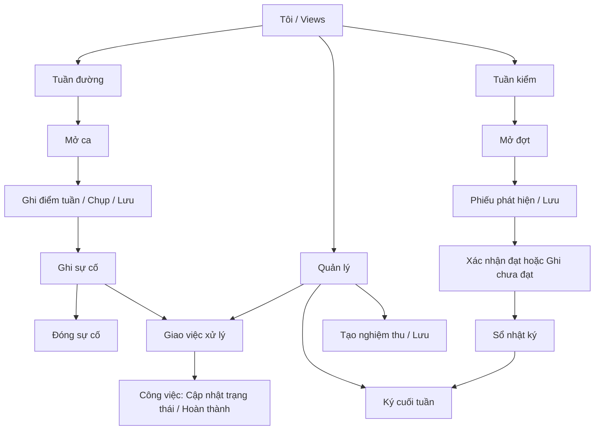

# Workflow 3 view RMMS

Ngày: 2026-10-29  
App: `Linm.Web.RMMS.Mobile` · https://rmms.vn/m  
View: `tuan-duong` · `tuan-kiem` · `quan-ly` (`viewRole.ts`)  
Màn chọn view: **Tôi** → **Views**. Dòng UI: **Menu và form đổi theo view này trong phiên đăng nhập.**

Một phiên một view. `nghiem-thu` và `ql-hat` trên phiên cũ đọc thành `quan-ly`. Tab dưới của Quản lý vẫn ghi **Nghiệm thu**.

## Chuỗi việc

Tuần đường ghi hiện trường. Quản lý giao việc và lập phiếu nghiệm thu. Tuần kiểm đối chiếu và xác nhận phiếu. Người được giao cập nhật tiến độ trên **Công việc**.

## Việc từng view

| Việc | Tuần đường | Tuần kiểm | Quản lý |
|------|------------|-----------|---------|
| Mở ca, Ghi điểm tuần, Kết thúc ca | Ghi | Không | Không |
| Nhật ký trong ca, Ghi sự cố, Đóng sự cố | Ghi | Xem cùng tuyến của đợt | Xem, không tạo hộ, không đóng hộ |
| Mở đợt, phiếu phát hiện, Xác nhận đạt, Ghi chưa đạt | Không | Ghi | Không xác nhận hộ |
| Sổ nhật ký | Không | Ghi đối chiếu Khớp / Lệch | Ký cuối tuần |
| Giao việc, Giao việc xử lý | Không | Không | Ghi |
| Công tác nghiệm thu, Lưu, Lưu nháp, Nghiệm thu | Không | Chỉ đọc phiếu đã Xác nhận đạt | Lập và lưu |
| Giám sát, Bản đồ camera, Thông tin tài sản | Không | Không | Xem |
| Cập nhật trạng thái, Hoàn thành | Đơn vị được giao | Không bấm hộ | Theo dõi, không bấm hộ |

## Tab và ô trang chủ

| View | Vào sau đăng nhập | Tab dưới | Ô trang chủ |
|------|-------------------|----------|-------------|
| Tuần đường | `/tuan-duong` | Trang Chủ, Tuần đường, Vấn đề, Công việc, Tôi | Tuần đường, Công việc, Vấn đề, Tài sản, Lưu trữ |
| Tuần kiểm | `/tuan-kiem` | Trang Chủ, Tuần kiểm, Vấn đề, Công việc, Tôi | Tuần kiểm, Sự cố của đợt, Phiếu phát hiện, Sổ nhật ký, Công việc, Vấn đề |
| Quản lý | `/trang-chu` | Trang Chủ, Nghiệm thu, Vấn đề, Công việc, Tôi | Giám sát, Bản đồ camera, Thông tin tài sản, Công tác nghiệm thu, Giao việc, Công việc, Vấn đề |

## Nút ghi

| Nhãn | Khi bấm | Kết quả |
|------|---------|---------|
| Mở ca | Tuần đường, chưa có ca đang tuần. Đủ Cột KM từ và đến. | Ca **Đang tuần**. Thiếu cột: **Nhập cột KM từ và đến trước khi mở ca.** |
| Ghi điểm tuần → Lưu hoặc Ghi nhận điểm tuần | Trong ca. Đủ tuyến và Cột KM. | Điểm tuần đã ghi. Thiếu cột: **Nhập cột KM trước khi lưu.** |
| Chụp / Chụp thêm / Xóa ảnh | Camera được phép. | Ảnh ghim vị trí, lưu cùng phiếu. Từ chối quyền: **Chưa được phép dùng camera.** |
| Kết thúc ca | Ca đang tuần. | Ca **Xong**. |
| Đóng sự cố | View Tuần đường, sự cố chưa đóng. | Trạng thái **Đã đóng**. |
| Mở đợt | Tuần kiểm. Đủ cột KM hai đầu. | Đợt đang kiểm. Thiếu cột: **Nhập cột KM từ và đến trước khi mở đợt.** |
| Lưu trên phiếu phát hiện | Tuần kiểm. | Phiếu của đợt. |
| Xác nhận đạt / Ghi chưa đạt | Tuần kiểm, đã chọn Kết luận. | Phiếu đạt hoặc chưa đạt. |
| Giao việc | Quản lý, dòng **Đợi phân công giám sát**. | Mở form giao. |
| Giao | Đủ Người nhận, Đơn vị bảo dưỡng, Hạng mục, Hạn xử lý. | **Đã giao việc.** Hạn sửa được theo gợi ý Phụ lục IV. |
| Ký cuối tuần | Quản lý, sổ chưa **Đã ký**. | Trạng thái **Đã ký**. Tuần kiểm thấy **Chỉ quản lý ký. Tuần kiểm không ký hộ.** |
| Tạo nghiệm thu → Lưu | Quản lý. Đủ mẫu, tuyến, hiện trường, người NT, thời điểm NT. | Phiếu nghiệm thu. |
| Lưu nháp | Phiếu chưa đủ để chốt. | Trạng thái **Nháp**. |
| Nghiệm thu | Đã ký tay trên khung. | **Đã ký**. |
| Cập nhật trạng thái / Hoàn thành | Người được giao. | **Đang xử lý** hoặc **Đã hoàn thành**. |

## Camera

Cùng control `RouteCaptureControl` trên điểm tuần, nhật ký, sự cố, phiếu phát hiện và phiếu nghiệm thu.

1. Nhấn **Chụp**. Máy từ chối quyền thì hiện **Chưa được phép dùng camera**.
2. Chụp xong, ghim vật thể trên ảnh. Chưa ghim: **Chưa ghim vật thể trên ảnh**.
3. Chọn tuyến trong **Tuyến gần vị trí** khi có nhiều tuyến.
4. **Xóa ảnh** bỏ ảnh chưa lưu. **Chụp thêm** khi phiếu nhận nhiều ảnh.
5. Lưu phiếu kèm ảnh. Sự cố bắt **Chụp ảnh trước khi lưu.**

## Hạn xử lý

Quản lý chọn **Hạn xử lý** lúc giao. Ô ghi: **Gợi ý Phụ lục IV theo hạng mục. Sửa được.** Không dùng hạn mặc định 24 giờ. Tuần kiểm lấy hạn đó khi xác nhận. Phiếu điện thoại giữ **Đạt** / **Không đạt** / **Khấu trừ**. Phần mềm không tính số tiền Mục IV.
